# 🎧 iRiver Theme

**A cozy, rounded SillyTavern UI theme inspired by 2000s MP3 players.**

- **12 color palettes** — 7 light / 5 dark
- **2 dialogue styles per color** — Default Dialogue / Highlighter
- **24 ready-to-import SillyTavern UI theme JSON files**
- Original Notion release: **v2.1** (theme content preserved)

> This repository distributes **UI theme JSON files**, not a SillyTavern extension. Import a JSON under **User Settings → UI Theme → Import a theme file**.

## 📸 Preview

  <a href="assets/overview.jpeg">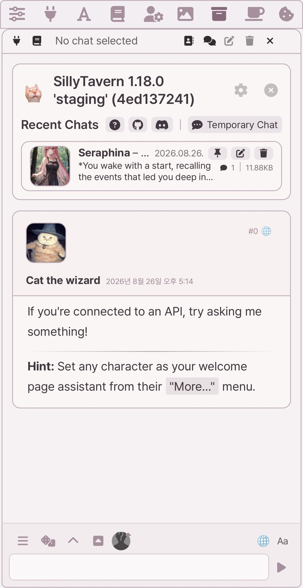</a>

## 📥 Downloads

**[Download all 12 colors / 24 JSONs (ZIP)](https://raw.githubusercontent.com/AmbasaS2/iriver-theme/main/downloads/iRiver_Theme_Complete.zip)**

Choose a color below to download its two variants together, or download one JSON directly. These links use stable filenames, so future updates can replace the files without changing the download addresses.

### 🎨 Light themes · 7 palettes

<table>
  <tr>
    <td align="center" valign="top" width="50%">
      <strong>Plum Milk 🍑🥛</strong> 
      <a href="assets/previews/Plum_Milk.jpeg">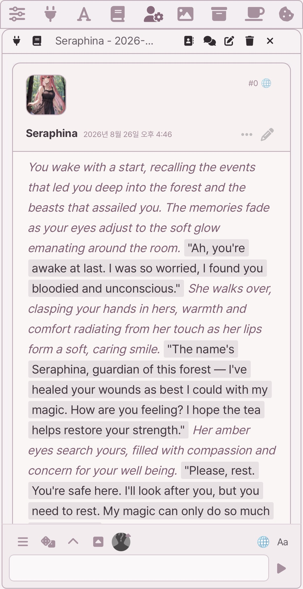</a> 
      <a href="https://raw.githubusercontent.com/AmbasaS2/iriver-theme/main/themes/light/iRiver_Plum_Milk_Default_Dialogue.json">Default Dialogue JSON</a> · <a href="https://raw.githubusercontent.com/AmbasaS2/iriver-theme/main/themes/light/iRiver_Plum_Milk_Highlighter.json">Highlighter JSON</a> 
      <a href="https://raw.githubusercontent.com/AmbasaS2/iriver-theme/main/downloads/iRiver_Theme_Plum_Milk.zip">Download color ZIP</a>
    </td>
    <td align="center" valign="top" width="50%">
      <strong>Blueberry Cheesecake 🫐</strong> 
      <a href="assets/previews/Blueberry_Cheesecake.jpeg">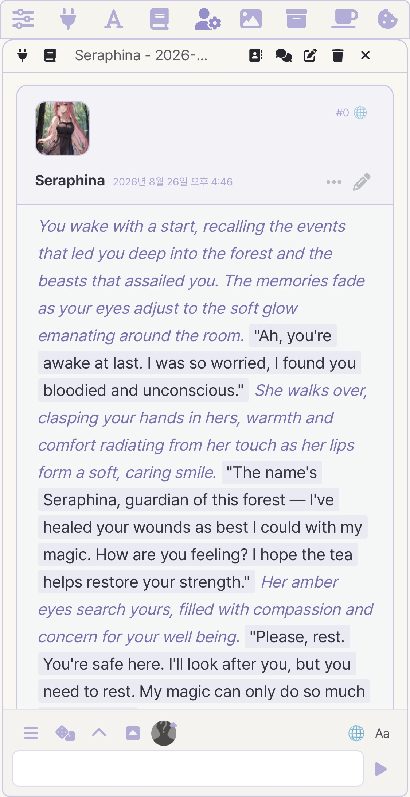</a> 
      <a href="https://raw.githubusercontent.com/AmbasaS2/iriver-theme/main/themes/light/iRiver_Blueberry_Cheesecake_Default_Dialogue.json">Default Dialogue JSON</a> · <a href="https://raw.githubusercontent.com/AmbasaS2/iriver-theme/main/themes/light/iRiver_Blueberry_Cheesecake_Highlighter.json">Highlighter JSON</a> 
      <a href="https://raw.githubusercontent.com/AmbasaS2/iriver-theme/main/downloads/iRiver_Theme_Blueberry_Cheesecake.zip">Download color ZIP</a>
    </td>
  </tr>
  <tr>
    <td align="center" valign="top" width="50%">
      <strong>Fig Campagne 🫓</strong> 
      <a href="assets/previews/Fig_Campagne.jpeg">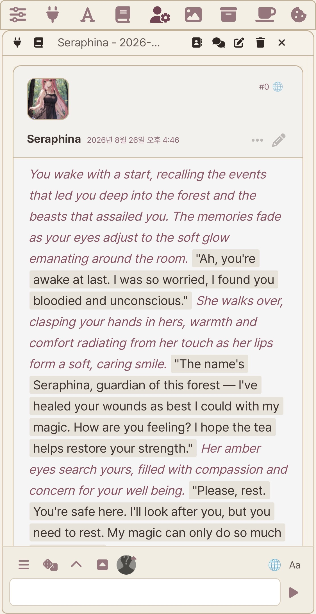</a> 
      <a href="https://raw.githubusercontent.com/AmbasaS2/iriver-theme/main/themes/light/iRiver_Fig_Campagne_Default_Dialogue.json">Default Dialogue JSON</a> · <a href="https://raw.githubusercontent.com/AmbasaS2/iriver-theme/main/themes/light/iRiver_Fig_Campagne_Highlighter.json">Highlighter JSON</a> 
      <a href="https://raw.githubusercontent.com/AmbasaS2/iriver-theme/main/downloads/iRiver_Theme_Fig_Campagne.zip">Download color ZIP</a>
    </td>
    <td align="center" valign="top" width="50%">
      <strong>Finder Blue 🩵</strong> 
      <a href="assets/previews/Finder_Blue.jpeg">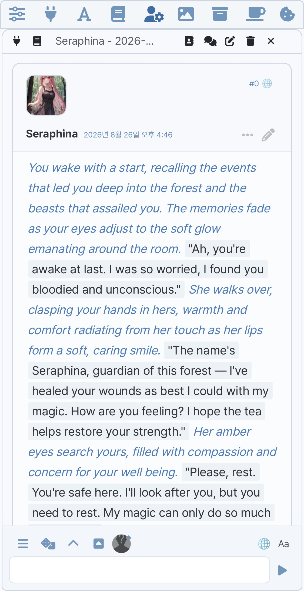</a> 
      <a href="https://raw.githubusercontent.com/AmbasaS2/iriver-theme/main/themes/light/iRiver_Finder_Blue_Default_Dialogue.json">Default Dialogue JSON</a> · <a href="https://raw.githubusercontent.com/AmbasaS2/iriver-theme/main/themes/light/iRiver_Finder_Blue_Highlighter.json">Highlighter JSON</a> 
      <a href="https://raw.githubusercontent.com/AmbasaS2/iriver-theme/main/downloads/iRiver_Theme_Finder_Blue.zip">Download color ZIP</a>
    </td>
  </tr>
  <tr>
    <td align="center" valign="top" width="50%">
      <strong>Fog Gray 🩶</strong> 
      <a href="assets/previews/Fog_Gray.jpeg">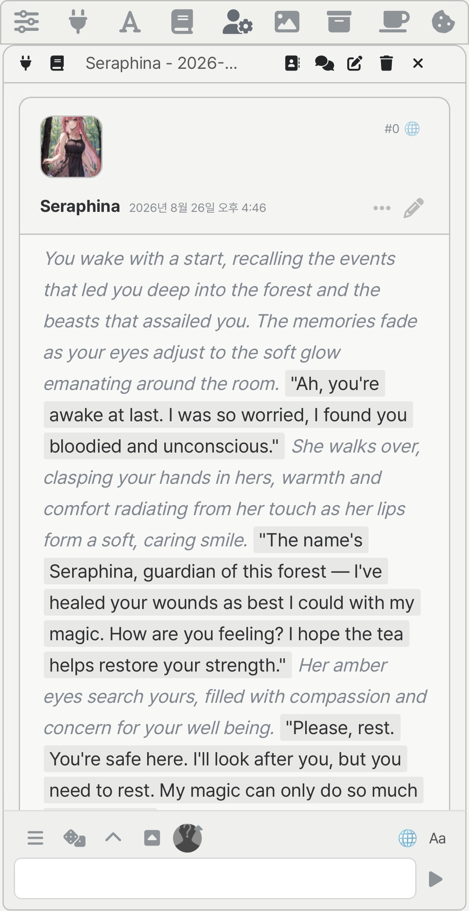</a> 
      <a href="https://raw.githubusercontent.com/AmbasaS2/iriver-theme/main/themes/light/iRiver_Fog_Gray_Default_Dialogue.json">Default Dialogue JSON</a> · <a href="https://raw.githubusercontent.com/AmbasaS2/iriver-theme/main/themes/light/iRiver_Fog_Gray_Highlighter.json">Highlighter JSON</a> 
      <a href="https://raw.githubusercontent.com/AmbasaS2/iriver-theme/main/downloads/iRiver_Theme_Fog_Gray.zip">Download color ZIP</a>
    </td>
    <td align="center" valign="top" width="50%">
      <strong>Pistachio Cherry 🍒</strong> 
      <a href="assets/previews/Pistachio_Cherry.jpeg">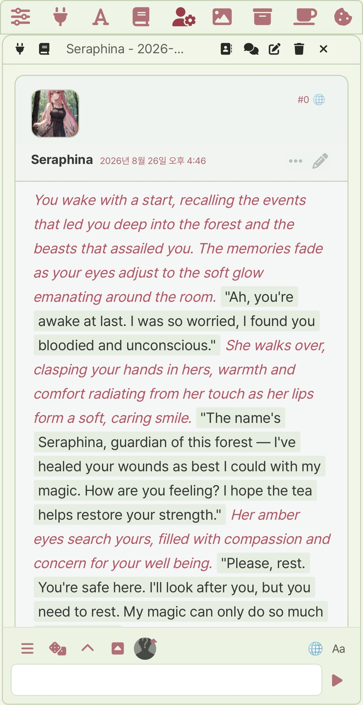</a> 
      <a href="https://raw.githubusercontent.com/AmbasaS2/iriver-theme/main/themes/light/iRiver_Pistachio_Cherry_Default_Dialogue.json">Default Dialogue JSON</a> · <a href="https://raw.githubusercontent.com/AmbasaS2/iriver-theme/main/themes/light/iRiver_Pistachio_Cherry_Highlighter.json">Highlighter JSON</a> 
      <a href="https://raw.githubusercontent.com/AmbasaS2/iriver-theme/main/downloads/iRiver_Theme_Pistachio_Cherry.zip">Download color ZIP</a>
    </td>
  </tr>
  <tr>
    <td align="center" valign="top" width="50%">
      <strong>Redbean Cream 🫘🍨</strong> 
      <a href="assets/previews/Redbean_Cream.jpeg">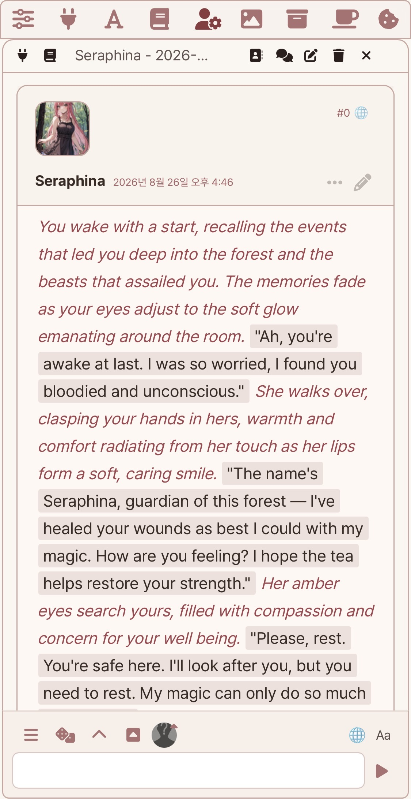</a> 
      <a href="https://raw.githubusercontent.com/AmbasaS2/iriver-theme/main/themes/light/iRiver_Redbean_Cream_Default_Dialogue.json">Default Dialogue JSON</a> · <a href="https://raw.githubusercontent.com/AmbasaS2/iriver-theme/main/themes/light/iRiver_Redbean_Cream_Highlighter.json">Highlighter JSON</a> 
      <a href="https://raw.githubusercontent.com/AmbasaS2/iriver-theme/main/downloads/iRiver_Theme_Redbean_Cream.zip">Download color ZIP</a>
    </td>
  </tr>
</table>

### 🌙 Dark themes · 5 palettes

<table>
  <tr>
    <td align="center" valign="top" width="50%">
      <strong>Riddle Diary ✒️</strong> 
      <a href="assets/previews/Riddle_Diary.jpeg">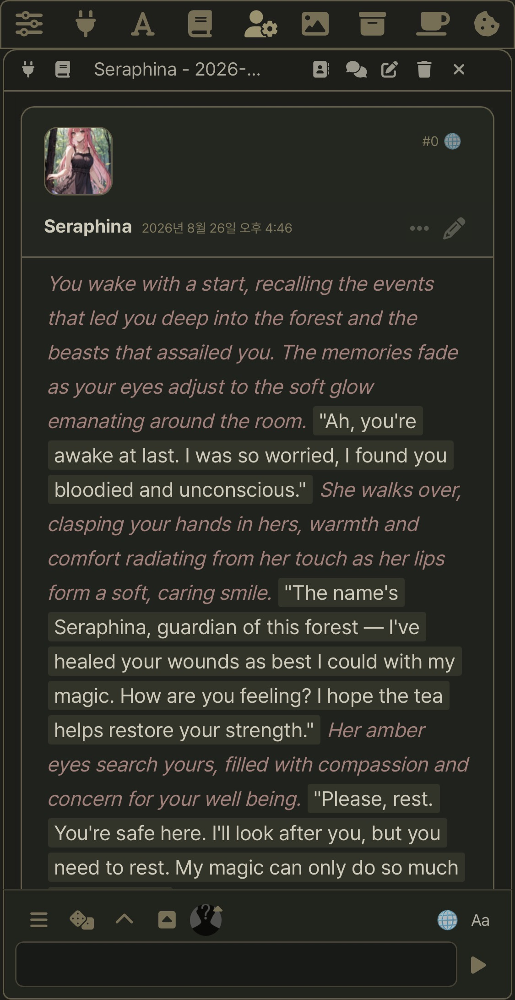</a> 
      <a href="https://raw.githubusercontent.com/AmbasaS2/iriver-theme/main/themes/dark/iRiver_Riddle_Diary_Default_Dialogue.json">Default Dialogue JSON</a> · <a href="https://raw.githubusercontent.com/AmbasaS2/iriver-theme/main/themes/dark/iRiver_Riddle_Diary_Highlighter.json">Highlighter JSON</a> 
      <a href="https://raw.githubusercontent.com/AmbasaS2/iriver-theme/main/downloads/iRiver_Theme_Riddle_Diary.zip">Download color ZIP</a>
    </td>
    <td align="center" valign="top" width="50%">
      <strong>Gryffindor 🦁</strong> 
      <a href="assets/previews/Gryffindor_Dark.jpeg">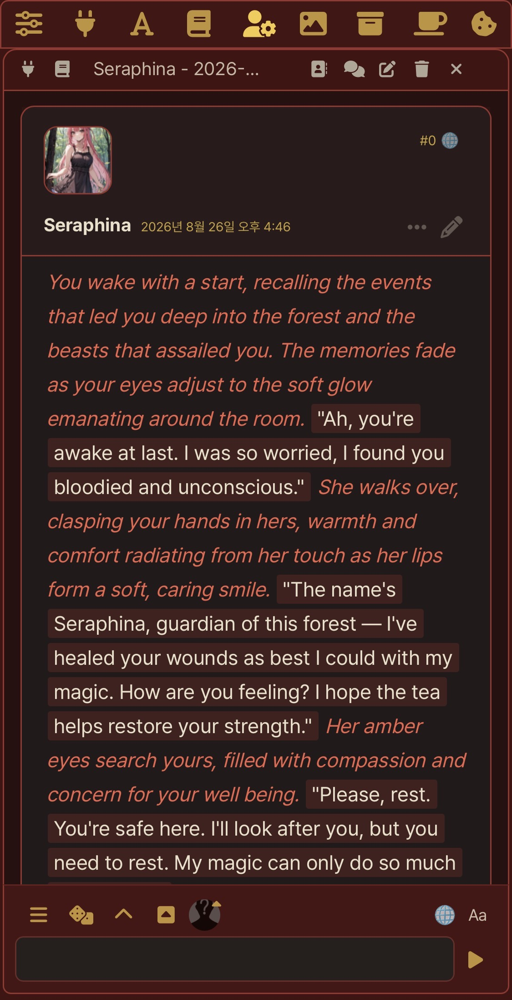</a> 
      <a href="https://raw.githubusercontent.com/AmbasaS2/iriver-theme/main/themes/dark/iRiver_Gryffindor_Dark_Default_Dialogue.json">Default Dialogue JSON</a> · <a href="https://raw.githubusercontent.com/AmbasaS2/iriver-theme/main/themes/dark/iRiver_Gryffindor_Dark_Highlighter.json">Highlighter JSON</a> 
      <a href="https://raw.githubusercontent.com/AmbasaS2/iriver-theme/main/downloads/iRiver_Theme_Gryffindor_Dark.zip">Download color ZIP</a>
    </td>
  </tr>
  <tr>
    <td align="center" valign="top" width="50%">
      <strong>Slytherin 🐍</strong> 
      <a href="assets/previews/Slytherin_Dark.jpeg">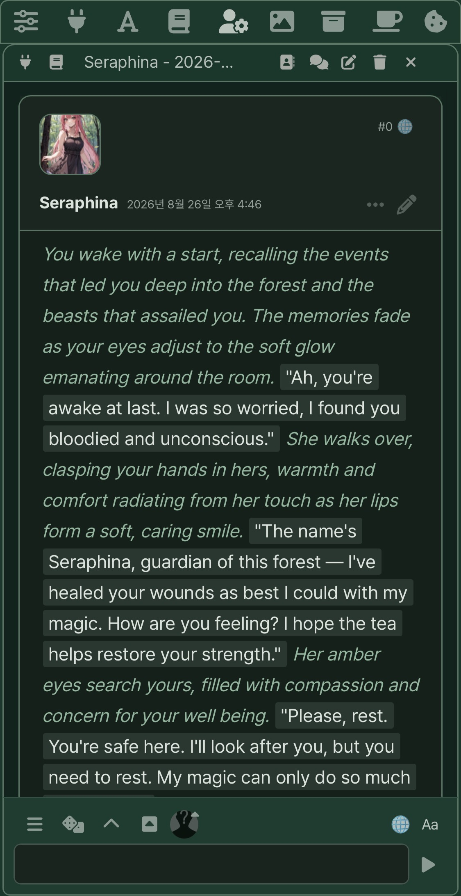</a> 
      <a href="https://raw.githubusercontent.com/AmbasaS2/iriver-theme/main/themes/dark/iRiver_Slytherin_Dark_Default_Dialogue.json">Default Dialogue JSON</a> · <a href="https://raw.githubusercontent.com/AmbasaS2/iriver-theme/main/themes/dark/iRiver_Slytherin_Dark_Highlighter.json">Highlighter JSON</a> 
      <a href="https://raw.githubusercontent.com/AmbasaS2/iriver-theme/main/downloads/iRiver_Theme_Slytherin_Dark.zip">Download color ZIP</a>
    </td>
    <td align="center" valign="top" width="50%">
      <strong>Hufflepuff 🦡</strong> 
      <a href="assets/previews/Hufflepuff_Dark.jpeg">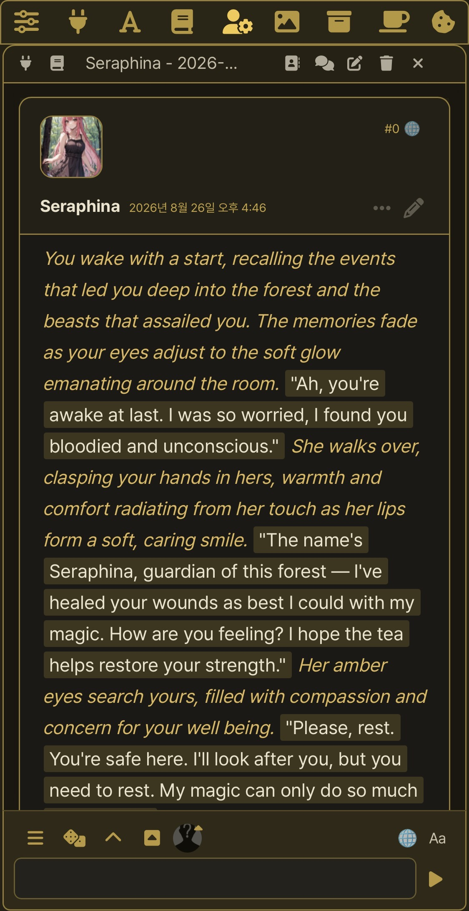</a> 
      <a href="https://raw.githubusercontent.com/AmbasaS2/iriver-theme/main/themes/dark/iRiver_Hufflepuff_Dark_Default_Dialogue.json">Default Dialogue JSON</a> · <a href="https://raw.githubusercontent.com/AmbasaS2/iriver-theme/main/themes/dark/iRiver_Hufflepuff_Dark_Highlighter.json">Highlighter JSON</a> 
      <a href="https://raw.githubusercontent.com/AmbasaS2/iriver-theme/main/downloads/iRiver_Theme_Hufflepuff_Dark.zip">Download color ZIP</a>
    </td>
  </tr>
  <tr>
    <td align="center" valign="top" width="50%">
      <strong>Ravenclaw 🦅</strong> 
      <a href="assets/previews/Ravenclaw_Dark.jpeg">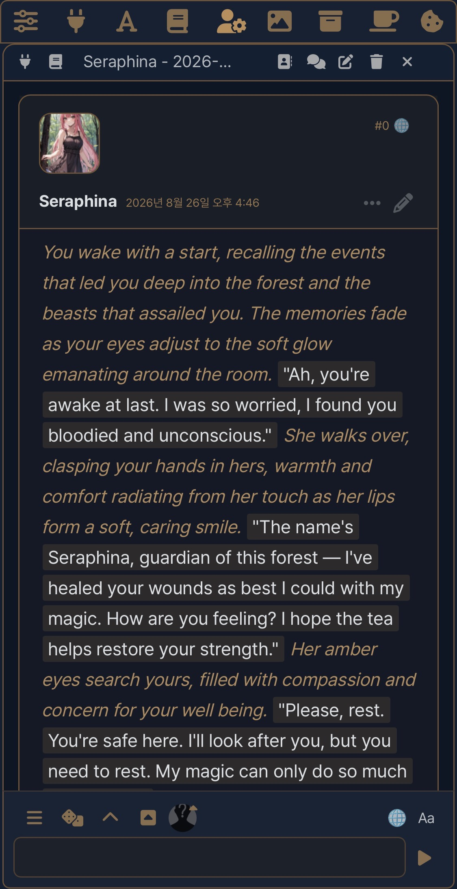</a> 
      <a href="https://raw.githubusercontent.com/AmbasaS2/iriver-theme/main/themes/dark/iRiver_Ravenclaw_Dark_Default_Dialogue.json">Default Dialogue JSON</a> · <a href="https://raw.githubusercontent.com/AmbasaS2/iriver-theme/main/themes/dark/iRiver_Ravenclaw_Dark_Highlighter.json">Highlighter JSON</a> 
      <a href="https://raw.githubusercontent.com/AmbasaS2/iriver-theme/main/downloads/iRiver_Theme_Ravenclaw_Dark.zip">Download color ZIP</a>
    </td>
  </tr>
</table>

The preview images show the **Highlighter** variant, as in the original Notion showcase.

## ✨ Dialogue styles

**Default Dialogue** — dialogue/quotes use the regular quote styling without a marker-like background.

**Highlighter** — dialogue/quotes receive a soft highlight using the theme's colors.

Each pair has the same base color palette; the dialogue CSS differs.

## 📥 How to install

1. Download a **color ZIP** or the **complete ZIP**, and extract it. Alternatively, download the desired JSON directly.
2. In SillyTavern, open **User Settings → UI Theme → Import a theme file**.
3. Select your **iRiver_..._Default_Dialogue.json** or **iRiver_..._Highlighter.json**.
4. To change colors or dialogue styles, import the corresponding JSON and choose it from the UI theme list.

**Already using custom CSS?** Save your current CSS separately before switching themes. The original Notion release recommends the **Persistent-Custom-CSS** extension for retaining your own customization. Third-party community CSS collections and font-extension assets are not redistributed with these themes.

**Updating:** New commits on GitHub do **not** automatically replace themes you already imported into SillyTavern. Download and import the updated JSON when you want the new version. The download links remain the same.

## 🧭 UI tour

Expand the original v2.1 screenshots of SillyTavern settings and menus

<strong>OpenAI tab</strong> <a href="assets/guide/openai-tab.jpeg">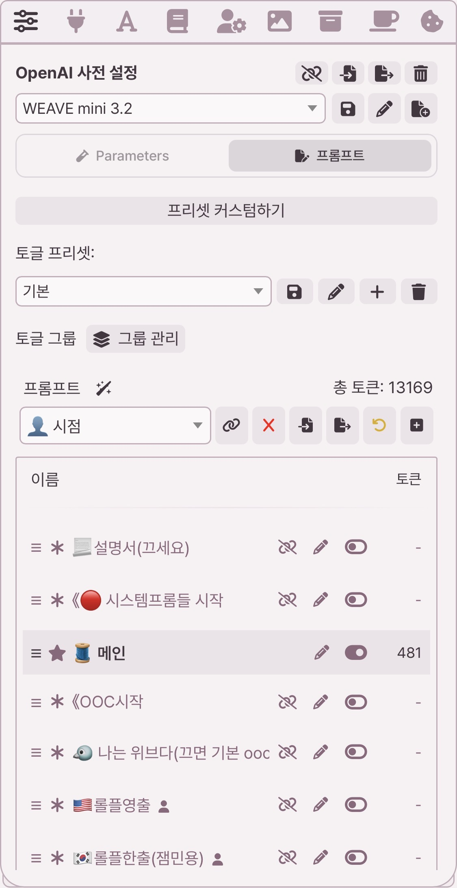</a>

<strong>Connection Profiles</strong> <a href="assets/guide/connection-profiles.jpeg">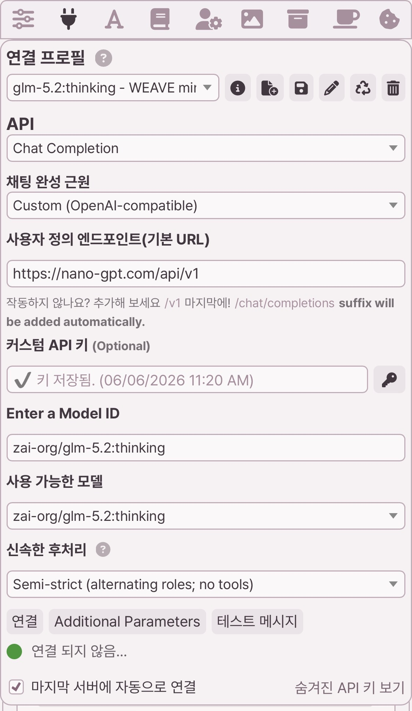</a>

<strong>Advanced Formatting</strong> <a href="assets/guide/advanced-formatting.jpeg">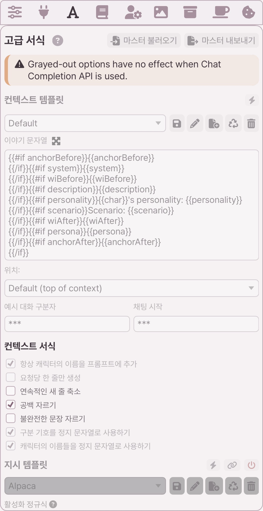</a>

<strong>User Settings</strong> <a href="assets/guide/user-settings.jpeg">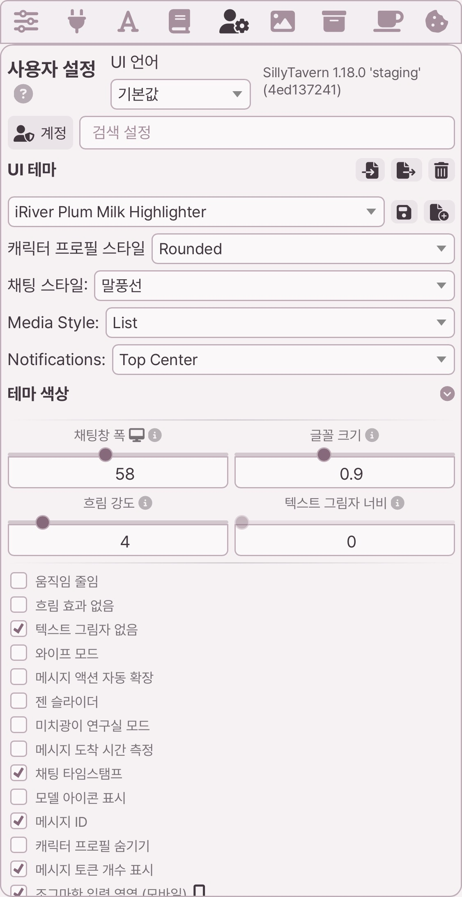</a>

<strong>World Info (without Lorebook Manager)</strong> <a href="assets/guide/lorebook-standard.jpeg">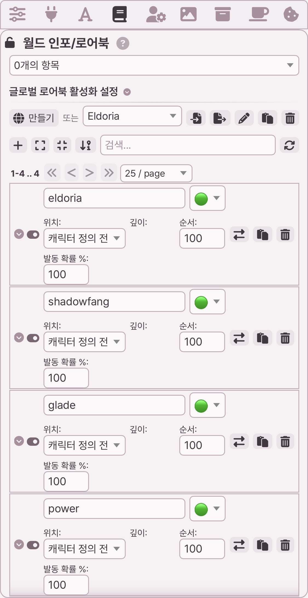</a>

<strong>World Info (with Lorebook Manager)</strong> <a href="assets/guide/lorebook-manager.jpeg">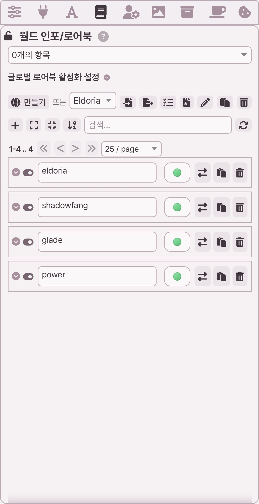</a>

<strong>Backgrounds</strong> <a href="assets/guide/backgrounds.jpeg">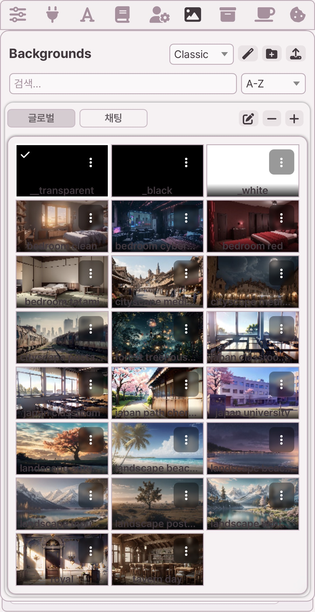</a>

<strong>Extensions</strong> <a href="assets/guide/extensions.jpeg">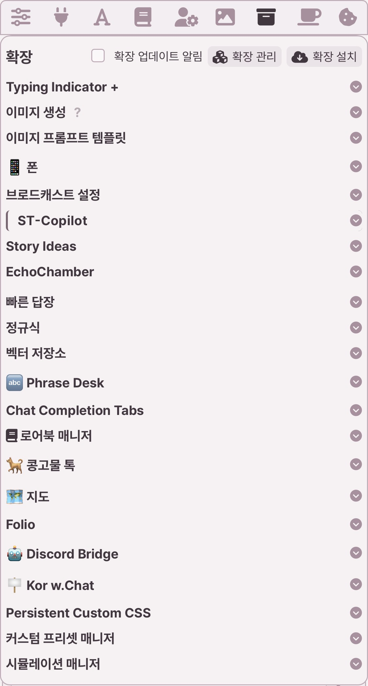</a>

<strong>Character Management</strong> <a href="assets/guide/characters.jpeg">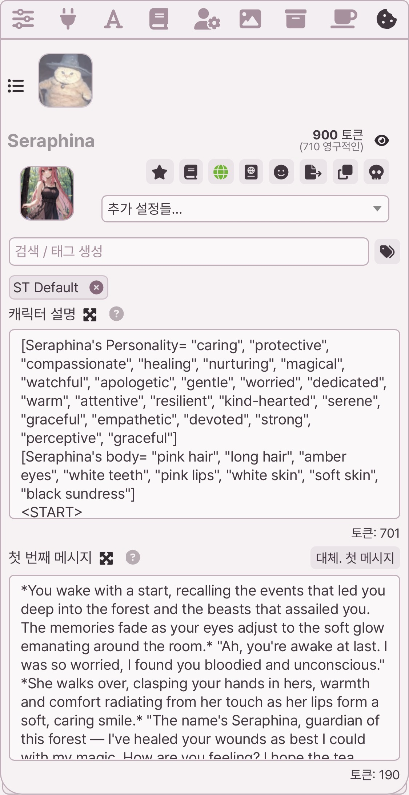</a>

## 💛 Acknowledgements

The original release warmly thanks the creators/contributors behind **Persistent-Custom-CSS**, the community **CSS reference post**, and the **SillyTavern font extension**. Their work made it much easier to share a theme without bundling someone else's CSS or font resources. The separate custom CSS and fonts remain their respective creators' work.

---

# 🎧 아이리버 테마

**2000년대 MP3 플레이어처럼 작고 동글동글한 화면을 꾸미는 실리태번 UI 테마야.**

- **12가지 색상** — 라이트 7종, 다크 5종
- **색상마다 2가지 대사 스타일** — 기본 대사 / 형광펜
- **총 24개의 SillyTavern UI 테마 JSON**
- 노션 공개본 **v2.1**을 내용 변경 없이 옮긴 최초 배포

이 저장소는 **실리태번 확장 프로그램이 아니라 UI 테마 파일 모음**이야. 확장 설치창에 GitHub 주소를 입력하는 방식이 아니라 **사용자 설정 → UI 테마 → 테마 파일 가져오기**를 사용해 줘.

## 📥 전체 다운로드

**[12색 · 24개 JSON 전체 다운로드 (ZIP)](https://raw.githubusercontent.com/AmbasaS2/iriver-theme/main/downloads/iRiver_Theme_Complete.zip)**

원하는 색상 ZIP만 다운로드해도 그 안에 **기본 대사와 형광펜 두 가지 JSON**이 들어 있어. 개별 JSON도 바로 받을 수 있도록 준비했어.

### 🍑 라이트 테마

- **플럼 밀크** (Plum Milk 🍑🥛) — [색상 ZIP](https://raw.githubusercontent.com/AmbasaS2/iriver-theme/main/downloads/iRiver_Theme_Plum_Milk.zip) · [기본 대사 JSON](https://raw.githubusercontent.com/AmbasaS2/iriver-theme/main/themes/light/iRiver_Plum_Milk_Default_Dialogue.json) · [형광펜 JSON](https://raw.githubusercontent.com/AmbasaS2/iriver-theme/main/themes/light/iRiver_Plum_Milk_Highlighter.json)
- **블루베리 치즈케이크** (Blueberry Cheesecake 🫐) — [색상 ZIP](https://raw.githubusercontent.com/AmbasaS2/iriver-theme/main/downloads/iRiver_Theme_Blueberry_Cheesecake.zip) · [기본 대사 JSON](https://raw.githubusercontent.com/AmbasaS2/iriver-theme/main/themes/light/iRiver_Blueberry_Cheesecake_Default_Dialogue.json) · [형광펜 JSON](https://raw.githubusercontent.com/AmbasaS2/iriver-theme/main/themes/light/iRiver_Blueberry_Cheesecake_Highlighter.json)
- **무화과 깜빠뉴** (Fig Campagne 🫓) — [색상 ZIP](https://raw.githubusercontent.com/AmbasaS2/iriver-theme/main/downloads/iRiver_Theme_Fig_Campagne.zip) · [기본 대사 JSON](https://raw.githubusercontent.com/AmbasaS2/iriver-theme/main/themes/light/iRiver_Fig_Campagne_Default_Dialogue.json) · [형광펜 JSON](https://raw.githubusercontent.com/AmbasaS2/iriver-theme/main/themes/light/iRiver_Fig_Campagne_Highlighter.json)
- **파인더 블루** (Finder Blue 🩵) — [색상 ZIP](https://raw.githubusercontent.com/AmbasaS2/iriver-theme/main/downloads/iRiver_Theme_Finder_Blue.zip) · [기본 대사 JSON](https://raw.githubusercontent.com/AmbasaS2/iriver-theme/main/themes/light/iRiver_Finder_Blue_Default_Dialogue.json) · [형광펜 JSON](https://raw.githubusercontent.com/AmbasaS2/iriver-theme/main/themes/light/iRiver_Finder_Blue_Highlighter.json)
- **포그 그레이** (Fog Gray 🩶) — [색상 ZIP](https://raw.githubusercontent.com/AmbasaS2/iriver-theme/main/downloads/iRiver_Theme_Fog_Gray.zip) · [기본 대사 JSON](https://raw.githubusercontent.com/AmbasaS2/iriver-theme/main/themes/light/iRiver_Fog_Gray_Default_Dialogue.json) · [형광펜 JSON](https://raw.githubusercontent.com/AmbasaS2/iriver-theme/main/themes/light/iRiver_Fog_Gray_Highlighter.json)
- **피스타치오 체리** (Pistachio Cherry 🍒) — [색상 ZIP](https://raw.githubusercontent.com/AmbasaS2/iriver-theme/main/downloads/iRiver_Theme_Pistachio_Cherry.zip) · [기본 대사 JSON](https://raw.githubusercontent.com/AmbasaS2/iriver-theme/main/themes/light/iRiver_Pistachio_Cherry_Default_Dialogue.json) · [형광펜 JSON](https://raw.githubusercontent.com/AmbasaS2/iriver-theme/main/themes/light/iRiver_Pistachio_Cherry_Highlighter.json)
- **단팥 크림** (Redbean Cream 🫘🍨) — [색상 ZIP](https://raw.githubusercontent.com/AmbasaS2/iriver-theme/main/downloads/iRiver_Theme_Redbean_Cream.zip) · [기본 대사 JSON](https://raw.githubusercontent.com/AmbasaS2/iriver-theme/main/themes/light/iRiver_Redbean_Cream_Default_Dialogue.json) · [형광펜 JSON](https://raw.githubusercontent.com/AmbasaS2/iriver-theme/main/themes/light/iRiver_Redbean_Cream_Highlighter.json)

### 🌙 다크 테마

- **리들 다이어리** (Riddle Diary ✒️) — [색상 ZIP](https://raw.githubusercontent.com/AmbasaS2/iriver-theme/main/downloads/iRiver_Theme_Riddle_Diary.zip) · [기본 대사 JSON](https://raw.githubusercontent.com/AmbasaS2/iriver-theme/main/themes/dark/iRiver_Riddle_Diary_Default_Dialogue.json) · [형광펜 JSON](https://raw.githubusercontent.com/AmbasaS2/iriver-theme/main/themes/dark/iRiver_Riddle_Diary_Highlighter.json)
- **그리핀도르** (Gryffindor 🦁) — [색상 ZIP](https://raw.githubusercontent.com/AmbasaS2/iriver-theme/main/downloads/iRiver_Theme_Gryffindor_Dark.zip) · [기본 대사 JSON](https://raw.githubusercontent.com/AmbasaS2/iriver-theme/main/themes/dark/iRiver_Gryffindor_Dark_Default_Dialogue.json) · [형광펜 JSON](https://raw.githubusercontent.com/AmbasaS2/iriver-theme/main/themes/dark/iRiver_Gryffindor_Dark_Highlighter.json)
- **슬리데린** (Slytherin 🐍) — [색상 ZIP](https://raw.githubusercontent.com/AmbasaS2/iriver-theme/main/downloads/iRiver_Theme_Slytherin_Dark.zip) · [기본 대사 JSON](https://raw.githubusercontent.com/AmbasaS2/iriver-theme/main/themes/dark/iRiver_Slytherin_Dark_Default_Dialogue.json) · [형광펜 JSON](https://raw.githubusercontent.com/AmbasaS2/iriver-theme/main/themes/dark/iRiver_Slytherin_Dark_Highlighter.json)
- **후플푸프** (Hufflepuff 🦡) — [색상 ZIP](https://raw.githubusercontent.com/AmbasaS2/iriver-theme/main/downloads/iRiver_Theme_Hufflepuff_Dark.zip) · [기본 대사 JSON](https://raw.githubusercontent.com/AmbasaS2/iriver-theme/main/themes/dark/iRiver_Hufflepuff_Dark_Default_Dialogue.json) · [형광펜 JSON](https://raw.githubusercontent.com/AmbasaS2/iriver-theme/main/themes/dark/iRiver_Hufflepuff_Dark_Highlighter.json)
- **래번클로** (Ravenclaw 🦅) — [색상 ZIP](https://raw.githubusercontent.com/AmbasaS2/iriver-theme/main/downloads/iRiver_Theme_Ravenclaw_Dark.zip) · [기본 대사 JSON](https://raw.githubusercontent.com/AmbasaS2/iriver-theme/main/themes/dark/iRiver_Ravenclaw_Dark_Default_Dialogue.json) · [형광펜 JSON](https://raw.githubusercontent.com/AmbasaS2/iriver-theme/main/themes/dark/iRiver_Ravenclaw_Dark_Highlighter.json)

색상별 사진은 노션 공개본과 마찬가지로 **형광펜 버전**이야. 실제 미리보기는 위의 색상별 갤러리에서 확인해 줘.

## 🖍️ 기본 대사와 형광펜 차이

**기본 대사(Default Dialogue):** 대사에 별도 형광펜 배경을 넣지 않는 기본 인용문 스타일.

**형광펜(Highlighter):** 테마 색상에 어울리는 은은한 배경으로 대사 부분을 강조하는 스타일.

같은 색상의 두 JSON은 기본 테마 색상이 동일하고, 대사 표시 CSS가 달라.

## ⚙️ 적용 방법

1. 전체 ZIP 또는 원하는 색상의 ZIP을 다운로드하고 압축을 풀어 줘. 개별 JSON을 받아도 돼.
2. 실리태번 **사용자 설정 → UI 테마 → 테마 파일 가져오기**로 이동해.
3. 원하는 색상과 대사 스타일의 **.json 파일**을 선택해.
4. 다른 색상이나 스타일이 필요하면 해당 JSON을 추가로 가져와서 UI 테마 목록에서 선택하면 돼.

**기존에 커스텀 CSS를 많이 사용한다면:** 테마를 바꾸기 전에 사용 중인 CSS를 별도로 보관해 둬. 노션 공개본에서는 **Persistent-Custom-CSS** 확장을 이용해 기존 커스텀 환경을 보존하는 방법을 권장했어. 다른 제작자의 CSS나 폰트 확장 자료는 이 배포본에 무단 포함하지 않았어.

**업데이트에 관해:** GitHub 파일을 수정해도 이미 실리태번에 가져온 테마가 자동으로 바뀌지는 않아. 수정된 테마를 사용하려면 JSON을 다시 내려받아 가져와야 해. 대신 **GitHub 다운로드 주소는 그대로 유지**할 수 있으니, 노션에 파일을 매번 다시 올릴 필요는 없어.

## 🧭 테마 투어

위의 **UI tour**를 펼치면 노션에 게시했던 OpenAI, 연결 프로필, 고급 서식, 사용자 설정, 월드 인포, 배경, 확장, 캐릭터 관리 화면을 확인할 수 있어.

## 💛 감사 크레딧

원본 노션에서 이야기했듯 **Persistent-Custom-CSS 확장 제작자**, **커뮤니티 CSS 정리글 작성자**, **실리태번 폰트 확장 제작자**에게 감사해. 덕분에 다른 사람의 CSS와 폰트 리소스를 함부로 테마에 넣지 않고도 이 테마를 공유할 수 있었어.

---

## Copyright & License

Copyright © 2026 **AmbasaS2**

Licensed under the **GNU Affero General Public License v3.0 (AGPL-3.0)**.

See [LICENSE](LICENSE) and [NOTICE.txt](NOTICE.txt). Original Notion distribution: [iRiver Theme v2.1](https://app.notion.com/p/3a1a96b06fd48055b696e946f5ebe3b8).

